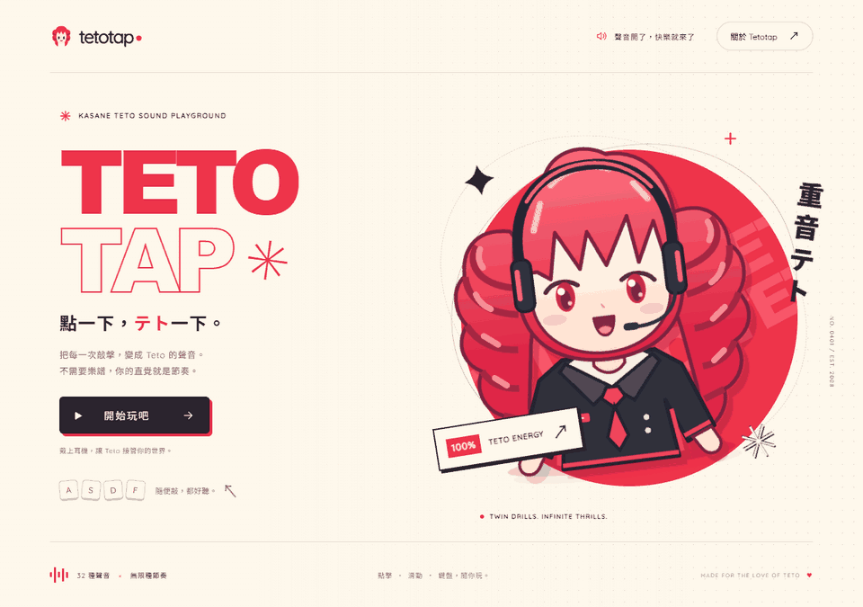

# Tetotap 🔥

點一下，テト一下。重音 Teto 的互動聲音遊樂場。

**[立即玩 Tetotap →](https://avianjay.github.io/tetotap/)**



- 奶油白與 Teto 紅的首頁、雙鑽頭角色插畫、網站圖示與繁體中文介面。
- 32 段重新合成的 Teto UTAU 歌唱短句，以及 140 BPM 的原創伴奏。
- A–Z、0–5 共 32 個聲音；也能用滑鼠點擊、拖曳或多指觸控演奏。
- 觸控光效與伴奏開關、全螢幕、演奏計數；設定儲存在瀏覽器。
- 支援手機版面與減少動態效果偏好；離開頁面或返回首頁會停止播放。
- 所有執行所需資產皆在專案內，播放時不依賴 CDN 或外部音源服務。

## 本機執行

不需要安裝前端套件或建置：

```sh
python -m http.server 4173 --bind 127.0.0.1
```

開啟 <http://127.0.0.1:4173>，按「開始玩吧」啟用音訊。
請透過 HTTP 伺服器開啟，讓瀏覽器可以載入音效 JSON。

也能使用原本的 Docker 配置：

```sh
docker build -t tetotap .
docker run --rm -p 8080:80 tetotap
```

## GitHub Pages 與預覽 GIF

推送到 `master` 後，[GitHub Actions](https://github.com/AvianJay/tetotap/actions/workflows/pages.yml) 會檢查 JavaScript 與 43 個音效，將必要的靜態檔案部署至 [GitHub Pages](https://avianjay.github.io/tetotap/)。也可以在 Actions 頁面手動執行部署。

更新介面後，可用 Playwright 與 Pillow 重新擷取首頁及實際鍵盤演奏，製作上方的 GIF：

```sh
python -m pip install playwright pillow
python -m playwright install chromium
python tools/render_preview.py
```

GIF 擷取透過瀏覽器的攔截請求讀取網站資產，不會啟動本機伺服器。

## 音效來源與重建

`data/main/main.json` 內含 32 段已完成的歌唱演奏，分為「て・と」、「ら・ら」、「か・さ・ね」、「て・と・て・と」四組；`data/track/track.json` 內含 11 個原創鼓聲、和弦與貝斯。原本的 Miku 人聲與伴奏已替換。

人聲使用 [Teto 官方 UTAU 單獨音](https://kasaneteto.jp/utau/)，透過 [UTAU 的 resampler](https://utau2008.xrea.jp/) 合成音高與時值、編排成音樂短句，再加入音量包絡與節奏回聲。網站不附原始聲庫、周波數檔或合成引擎。

需要重新製作音效時，在 Windows 安裝 Python、FFmpeg、`numpy` 與 `requests`，執行：

```sh
python tools/render_audio.py
```

腳本從官方網站下載來源至系統暫存目錄 `tetotap-assets`，不會把原始聲庫放進專案。一般開發或執行網站不需要這個步驟。

## 原作與致謝

互動動畫改編自 **[Mikutap](https://aidn.jp/mikutap/)**，原作者 **[daniwell](https://aidn.jp/)**；本專案基於 **[HFIProgramming 的獨立移植版](https://github.com/HFIProgramming/mikutap)**，原始靈感來自 **[Patatap](https://patatap.com/)**。原作者資訊同時保留於網站的「關於 Tetotap」。修改時請繼續保留這些來源與作者資訊。

Tetotap 是非官方粉絲二次創作。重音 Teto 角色權利歸 **線・小山乃舞世・TWINDRILL** 所有；UTAU 音聲製作為 **小山乃舞世**。Teto 的使用請參閱 [官方規範](https://kasaneteto.jp/guidelines/) 與 [音源使用條件](https://kasaneteto.jp/guidelines/voice.html)。原專案的音樂與動畫使用說明請參閱 [daniwell 的說明](https://aidn.jp/about/)；商業用途請聯絡原權利人。

沿用的程式庫為 PIXI.js 與 GSAP，保留各檔案內的原有權利資訊。
